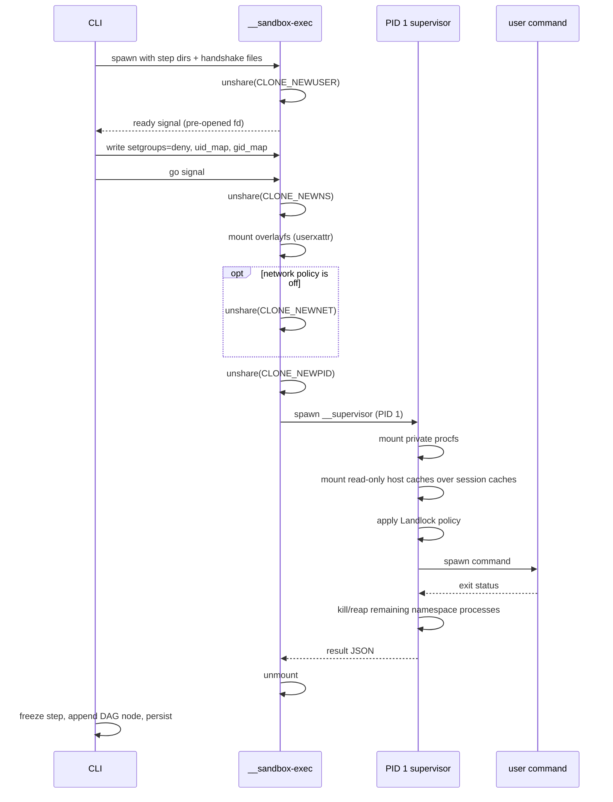

# cowbox architecture

## 1. Goals

cowbox makes local workspace mutations by an AI coding agent cheap to inspect
and cheap to reverse. It does this without a VM, without a container image, and
without replacing the developer's toolchain.

The M3 design retains the M2 engine and adds a protocol layer with six
properties:

1. **Millisecond setup.** The workspace is a read-only lowerdir; each step adds
   a writable upperdir on ext4.
2. **Deterministic state.** Every command invocation becomes a numbered DAG
   node. Rollback is a pointer move, not a copy.
3. **Host safety.** Writes outside the workspace are denied by Landlock and
   background processes are reaped in a PID namespace.
4. **Auditable commit.** The host is changed only through a journaled,
   drift-checked, topologically ordered commit.
5. **Explicit network policy.** Steps default to the host network; `off`
   removes IP connectivity in a private network namespace without a fallback.
6. **Agent-visible snapshots.** A stdio MCP proxy makes every upstream tool call
   a real cowbox step and reserves control tools for diff, rollback, and commit
   preview.

## 2. Non-goals for M3

- Selective destination filtering or packet-level network policy.
- A native Windows or macOS backend.
- HTTP/SSE MCP upstream transport, resources, prompts, or a long-lived upstream
  MCP process.
- MCP content inspection, policy rewriting, or hostile-server isolation beyond
  the existing process and filesystem boundary.
- Multi-agent parallel racing.
- Hostile-code containment equivalent to a VM.

## 3. Components

```text
┌─────────────────────────────────────────────────────────────────┐
│ cowbox-cli                                                      │
│ clap · session store · JSON/human rendering · helper · MCP      │
└───────────────┬─────────────────────────────────┬───────────────┘
                │                                 │
┌───────────────▼─────────────────┐  ┌────────────▼──────────────┐
│ cowbox-core                     │  │ cowbox-dag                │
│ LinuxBackend                    │  │ StepNode / SessionDag     │
│ namespaces · OverlayFS          │  │ rollback · undo · branch  │
│ Landlock · supervisor           │  │ validation · serde        │
│ diff · commit journal           │  └───────────────────────────┘
└───────────────┬─────────────────┘
                │
┌───────────────▼─────────────────────────────────────────────────┐
│ cowbox state                                                    │
│ workspaces/<hash>.json · sessions/<id>/...                      │
└─────────────────────────────────────────────────────────────────┘
```

### `cowbox-dag`

Pure in-memory and serializable state. It knows nothing about mounts, PIDs, or
the filesystem. `SessionDag` owns a `BTreeMap<u64, StepNode>`, a `head_step`, and
the workspace root. `add_step` enforces sequential ids and a parent equal to the
current head. `rollback` validates the target and moves the head. `undo` walks
parent links. `active_layer_chain` returns the root-to-head layer ids for
OverlayFS.

### `cowbox-core`

The engine. It owns the `SandboxBackend` trait, Linux namespace setup, overlay
mounting, Landlock policy, diff, commit, and capability probing. The rest of
the workspace must not call syscalls directly.

### `cowbox-cli`

Argument parsing, workspace discovery, state persistence, locks, rendering, and
the hidden `__sandbox-exec` / `__supervisor` helper entry points. The CLI
orchestrates; it does not reimplement the engine.

The M3 `mcp-proxy` and hidden `__mcp-adapter` live in the CLI. The proxy owns
the agent connection and orchestration; the adapter runs inside a sandbox step
and owns one upstream MCP initialize/call cycle. Neither duplicates OverlayFS,
Landlock, network, lock, or DAG logic.

## 4. State layout

The state root is selected in this order:

1. `$COWBOX_HOME`
2. `$XDG_STATE_HOME/cowbox`
3. `~/.local/state/cowbox`

It must be outside the workspace and on an xattr-capable Linux filesystem.

```text
<state-root>/
├── workspaces/
│   └── <sha256(workspace)[..16]>.json   # active session pointer
└── sessions/
    └── <8-hex-id>/
        ├── session.json                 # DAG + status + workspace
        ├── base/
        │   └── manifest.jsonl           # metadata snapshot at session start
        ├── steps/
        │   └── <n>/
        │       ├── upper/               # writable overlay layer
        │       └── work/                # overlay workdir
        ├── home/                        # redirected HOME
        ├── tmp/                         # redirected TMPDIR
        ├── cache/                       # redirected caches
        ├── cache-overlays/              # session writable halves of host caches
        ├── layers/
        │   ├── compacted/<key>/         # validated physical mount-layer cache
        │   └── tmp/                     # unpublished compaction attempts
        ├── events.jsonl                 # run/rollback/commit/discard audit
        ├── lock                         # flock for workspace mutation
        └── commit/<journal>/            # phase meta, ops, copy + link backups
```

A session is `Active`, `Committed`, or `Discarded`. Only one active session is
allowed per workspace in M2. After a successful commit the active pointer is
cleared; the next `run` creates a new session whose base is the updated host.

## 5. Run lifecycle



### Handshake

The child cannot open new paths between `unshare(CLONE_NEWUSER)` and the uid/gid
map write: its uid is unmapped. The helper therefore uses pre-opened file
descriptors for readiness and the "go" signal. The parent writes:

```text
/proc/<child>/setgroups  -> "deny"
/proc/<child>/uid_map    -> "0 <host-uid> 1"
/proc/<child>/gid_map    -> "0 <host-gid> 1"
```

If the maps cannot be written, the helper is killed and the CLI returns an
actionable isolation error. There is no fallback path.

### Overlay mounts

For a chain `[1, 2, 3]` the mount is:

```text
lowerdir=<state>/steps/3/upper:<state>/steps/2/upper:<state>/steps/1/upper:<workspace>
upperdir=<state>/steps/<next>/upper
workdir=<state>/steps/<next>/work
userxattr
```

The lower layers are ordered topmost-first. The base workspace remains the live
host directory. That is why the host must be treated as read-only while a
session is active.

### Network namespace policy

The resolved policy is `host` unless `cowbox run --network off` is present or
`.cowbox.toml` contains `[sandbox] network = "off"`. The precedence is CLI,
project configuration, then `host`.

For `off`, the helper calls `unshare(CLONE_NEWNET)` after the UID/GID map
handshake and after OverlayFS is mounted. It runs before `CLONE_NEWPID` and
before the supervisor can spawn the user command. The new namespace contains no
host interfaces and leaves loopback down. A failure returns
`NETWORK_NAMESPACE_FAILED` with exit code 125; the CLI removes the incomplete
step and never attempts a host-network fallback.

This policy isolates IP connectivity for IPv4 and IPv6 TCP/UDP traffic. It is
not a firewall, cannot allowlist destinations, and does not isolate
filesystem-backed Unix-domain sockets. A Unix socket remains an IPC boundary,
subject to the Landlock path policy.

The CLI stores a policy snapshot in `session.json` under a step-keyed
`run_policies` map. `run --json` returns the effective snapshot in
`data.policy`; `stats --json` returns the snapshot at the current DAG head. The
object has these fields:

| Field | Values |
| --- | --- |
| `recorded` | `true`; older sessions report `false` |
| `network` | `host`, `off`, or `unknown` for a legacy session |
| `network_source` | `cli`, `project`, `default`, or `legacy` |
| `isolated_caches` | Boolean cache-isolation setting |
| `host_caches` | Configured host cache tools in use |

The map is keyed by logical step id. Rollback changes the current snapshot
without rewriting history, and a new branch records its own policy on the next
step. The field defaults to an empty map when deserializing older sessions, so
the session schema remains version 1.

### Layer compaction

The DAG remains entirely logical. Compaction changes only the physical lower
layers passed to OverlayFS when the active branch approaches the 150-layer or
3800-byte `lowerdir` limit.

Before creating a step, core scans existing compaction metadata and reuses a
compacted layer only when its recorded logical source list is an exact prefix of
the active root-to-head chain. When another compaction is required, core:

1. selects the oldest contiguous prefix and keeps up to 32 recent logical
   layers uncompressed;
2. replays only those upper layers, using the base manifest to distinguish
   additions, modifications, type changes, and deletions;
3. materializes the net result in `layers/tmp/`, normalizing whiteouts to
   `user.overlay.whiteout`, preserving opaque directories, modes, symlinks,
   `user.*` xattrs, and hardlink groups;
4. analyzes the temporary result again and compares namespace semantics,
   content hashes, metadata, xattrs, whiteouts, opaque directories, and
   hardlink partitions with the source layers;
5. measures the temporary result while its permission elevation is still
   active;
6. restores every source and temporary mode, writes `layer.json` with the
   source layer ids and base-manifest fingerprint, then publishes the directory
   with an atomic rename.

The session lock serializes compaction with other session mutations and with
readers that need source-layer metadata. A process interruption leaves either
an unpublished temporary directory or a complete published layer; the next run
can clean up and retry. `stats` reports logical steps, physical lower layers
(including the live base), compacted-layer count, and allocated compacted bytes.
Finalized sessions include compaction artifacts in normal `gc` removal.

#### Permission transaction

An unprivileged process cannot read a `000` file or list a directory without
owner read/execute permission. Compaction, `diff`, and `commit` therefore use a
journaled permission transaction instead of a best-effort copy:

1. The journal is created lazily on the first mode change. New attempts write
   `layers/tmp/<attempt>.permissions.jsonl`; the legacy in-tree
   `layers/tmp/<attempt>/source-permissions.jsonl` location is still recovered.
2. Every directory mode is journaled and fsynced before it is elevated.
   Unreadable regular-file records are collected, fsynced as a batch, and only
   then given temporary read permission.
3. Readers (`diff` and `commit`) take the same exclusive session lock as
   compaction and replay pending journals before scanning. A started
   compaction and every subsequent reader therefore agree on the original
   modes.
4. Restore handles non-directories first and directories deepest-first.
   Missing ancestors are temporarily reopened while retrying, so a previous
   interruption that already restored a parent to `000` is recoverable.
5. The journal is removed only after every recorded mode has been restored.
   A final JSON line without a newline is treated as an incomplete append and
   only the complete prefix is restored. A malformed complete line, conflicting
   duplicate, unsafe path, or invalid mode is a state-corruption error and keeps
   the journal for diagnosis.
6. The temporary compacted tree is measured before its modes are restored, so
   `000` directories cannot make the disk-usage walk fail.

Source layers are restored before a successful command returns. If a command
fails or is interrupted after a mode change, it leaves either the original
modes or a durable journal that the next reader or writer recovers under the
session lock.

`diff` and `commit` always read `steps/<n>/upper` for the logical chain. They do
not substitute a compacted layer, so historical rollback and branching retain
the original per-step semantics.

### Host cache overlays

When `.cowbox.toml` enables a host cache, the supervisor mounts a second OverlayFS
inside the session mount namespace before applying Landlock:

```text
lowerdir=<host cache data, read-only>
upperdir=<session>/cache-overlays/<tool>/upper
workdir=<session>/cache-overlays/<tool>/work
userxattr
```

The destination is the same path already exported as `CARGO_HOME`, npm's
`NPM_CONFIG_CACHE`, or `PIP_CACHE_DIR`. Only cache data is mounted: Cargo
`registry/` and `git/`, npm `_cacache/`, and the pip cache directory. Host
credentials and configuration files are not part of the mount and remain
outside the sandbox. Any cache write copies up to the session upper layer.
Pip additionally receives a `PIP_FIND_LINKS` path for an optional read-only
`wheelhouse/` under the cache root.

## 6. Diff

The diff engine walks the active upper layers in root-to-head order and applies
their entries to a `BTreeMap<PathBuf, Change>`:

- A regular file, directory, or symlink is an upsert.
- A `0/0` character device is a whiteout.
- A file carrying `user.overlay.whiteout` is a whiteout.
- A directory with `user.overlay.opaque` removes all lower entries below it.
- A later layer always wins over an earlier layer.

At the end, the base manifest decides whether an upsert is `Added` or
`Modified`, and whether a whiteout is a real `Deleted`. Files that were added
and later removed net out. Symlink target changes become `SymlinkUpdated`.
Type changes become `TypeChanged`.

Only upper layers are scanned. The lowerdir is never walked or hashed during a
normal diff.

Text line counts are optional and capped by `max_line_stat_files` and
`max_line_stat_bytes`. Binary files report a size delta instead.

## 7. Commit

`commit` is intentionally conservative:

1. Compute the net diff from base to the target step.
2. Compare every affected host path with the base manifest. If the host
   changed, return `CommitConflict`; `--force` overrides but still backs up.
3. Create a `prepared` journal, copy every affected existing host path into it,
   record pre/post fingerprints, and write an operation manifest. Existing host
   files also get an original-inode hardlink backup when the filesystem allows
   it; the independent copy is the stable recovery source.
4. Apply in topological order:
   - delete removed paths, deepest first;
   - create directories, shallowest first;
   - write regular files to same-directory temporary files, fsync, apply
     `user.*` xattrs, rename;
   - preserve hardlinks among files in the same commit set;
   - recreate or replace symlinks last.
5. Keep SQLite `-wal`/`-shm`/`-journal` sidecars grouped with a changed
   database and delete stale host sidecars that are not present in an upper
   layer.
6. Strip setuid/setgid, preserve mode and mtime where possible, and refuse
   device/FIFO/socket entries.
7. Persist the `applied` phase only after every host write and fsync has
   succeeded. This is the durable commit point.
8. Save the committed session record and clear the active pointer. Only then
   mark the journal `complete` and remove its backup material.

If applying fails before the commit point, the journal moves to `restoring`,
restores the host, refreshes the base manifest, and records `rolled_back` while
keeping backups until those writes are durable. A process interruption at any
point leaves either an incomplete journal or a terminal one. `commit --recover`
checks the recorded operation manifest and pre/post fingerprints:

- `prepared`, `applying`, or `restoring`: restore the host and keep the original
  session active;
- `applied`: leave the committed host content in place, persist the committed
  session state, clear the active pointer, then finalize the journal;
- `complete` or `rolled_back`: no further host action; repeated recovery is a
  no-op.

External edits cause recovery to stop with an explicit error and retain the
journal and backups. The guarantee covers process interruption, not power loss
or storage failure.

Recovery also treats the commit's own `0700` directory preparation as a valid
intermediate state. Before restoring a directory tree, it walks the host subtree
and compares every entry with the journal operations and the base manifest.
Rollback stops when it finds unexpected entries, missing base entries, changed
descendants, or paths it cannot verify. Temporary-looking names are checked
like any other path. The journal and backups remain available so the user can
preserve the conflicting content before retrying recovery.

`.git` and `.cowbox` are never committed. Default excluded paths such as
`target/`, `node_modules/`, and `.venv/` are ignored unless
`--include-excluded` is explicit.

## 8. MCP proxy

`cowbox mcp-proxy` is a thin JSON-RPC layer that does not call the engine
directly. Tool discovery and every upstream `tools/call` run through a child
`cowbox run` process, reusing the existing session lock, OverlayFS setup,
Landlock, PID supervisor, and policy enforcement.

```text
agent harness (stdio JSON-RPC)
       |
       v
cowbox mcp-proxy (serialized event loop)
       |
       +-- tools/list --> cowbox run in temp state -> upstream init + paginated list
       |
       +-- tools/call --> cowbox run in active session -> adapter -> one init + call
```

Tool discovery uses a state root under `/tmp`, so the project's active session
is untouched. The result is cached for the proxy lifetime. Upstream names
colliding with reserved control tools are rejected.

Each upstream call is treated as write-capable and records a step. The upstream
process is started fresh for each call; cross-call state must live in workspace
files. Every tool result carries `_meta.cowbox` with the bound session,
`head_before`, actual `step`, `head_after`, exit status, timeout flag, and
rollback/commit commands. A visible content block repeats the snapshot summary.
`head_before` is read from the executed `run` result's locked `parent_step`, not
from an earlier observation, so a concurrent terminal step is never skipped by
the rollback hint.

The reserved control tools do not create steps:

- `cowbox_diff` runs the existing read-only diff path;
- `cowbox_rollback` moves the DAG head;
- `cowbox_commit` runs the existing dry-run and returns a terminal command.

Client disconnect, upstream timeout or abnormal exit, oversized output, and
protocol errors are converted into bounded JSON-RPC errors or `isError` tool
results. If a step was already recorded, the metadata still identifies it so
the agent can call `cowbox_rollback`.

Control commands receive the proxy's bound session explicitly. The CLI verifies
that this session is still the workspace's active pointer while holding the
session lock, so a concurrent pointer change cannot redirect a diff, rollback,
or commit dry-run into another session. Explicit network policy is also
forwarded as a CLI override; a project-level `off` cannot replace an explicit
`--network host`.

Returned terminal commands also include `--session <id>`. They remain safe to
reuse after a session switch: the CLI returns `SESSION_NOT_ACTIVE` and leaves
the new session untouched.

The adapter maps absolute upstream command arguments that start with the
workspace root into the merged overlay mount. This allows file-based MCP server
scripts under the workspace without granting read access to the live host path.
Relative paths already resolve inside the merged mount.

## 9. Observability

`tracing` spans cover namespace setup, mount, Landlock, diff, and commit.
`--trace-chrome` emits a Chrome Trace JSON file. `doctor` runs static capability
probes (namespace, overlay, `userxattr`, Landlock ABI, state filesystem, disk
space) and reports configured Cargo/npm/pip host cache data sources. The
whiteout kind is confirmed by the first real run, and latency is measured by
`scripts/bench.sh`.

`doctor --check-run [--network off]` additionally creates a temporary ext4
fixture and executes the real CLI, helper, mapping, overlay, network namespace,
Landlock, and user-command path. `run_check.stages` distinguishes state-disk,
user-namespace, network-namespace, OverlayFS, and Landlock failures.
Before creating the fixture, it checks that the configured state path
or its nearest existing parent is writable and searchable and that the
detected state filesystem is usable. `run_check.state_disk` reports the
configured path, inspected prefix, filesystem, access result, and detail.
`command_started` proves whether a setup failure prevented user code from
running. The ordinary static doctor JSON fields remain unchanged; plain
`doctor` still performs no write-access probe and creates no state directory.

`stats` reports logical step count, physical mount layers, compacted storage,
rollback count, reaped orphans, incremental disk use, the current policy
snapshot, and whether network isolation is active.

cowbox does **not** count blocked writes: Landlock denials are silent. The field is
reported as not instrumented rather than invented.

## 10. WSL2 bridge notes

The engine runs as a Linux binary inside WSL2. The native Windows launcher
forwards commands, including all `doctor` arguments, exit codes, and output
through `wsl.exe`. For `mcp-proxy`, it inherits stdin, stdout, and stderr so the
MCP JSON-RPC stream is neither decoded nor buffered:

- Source may be on `/mnt/e`; upper and work layers must be on ext4.
- `/mnt/e` works as a read-only lowerdir in testing, but 9p has different
  case-folding, symlink, and latency behavior. Acceptance tests use ext4.
- `WSL_INTEROP` must be unset and Windows PATH entries removed before spawning
  the command, otherwise a sandboxed process could invoke Windows binaries.

## 11. Failure modes

| Failure | Behavior |
| --- | --- |
| Kernel lacks user namespaces | `USER_NAMESPACE_FAILED`; command does not run |
| Network namespace creation fails | `NETWORK_NAMESPACE_FAILED`; command does not run |
| OverlayFS mount fails | `OVERLAYFS_FAILED`; no copy fallback |
| Landlock unavailable | `LANDLOCK_FAILED`; command does not run |
| State dir on 9p/without xattr | `CowUnsupported` with a path hint |
| State path not writable/searchable | active doctor reports `STATE_DISK_NOT_READY`; command never starts |
| Command times out | kill namespace, exit 124, record a step |
| Host file changed during session | commit conflict; `--force` still backs up |
| Commit interrupted | journal restore; manual recovery path if restore fails |
| Whiteout format differs from expectation | both char-device and xattr forms supported |
| Layer compaction interrupted | journaled modes restored before readers or retry; temporary output is discarded |
| Configured host cache data is missing | actionable config error before the command runs |
| MCP client disconnects mid-call | kill the sandbox process tree; proxy exits |
| MCP tool name conflicts with a reserved control | `tools/list` returns `MCP_TOOL_NAME_CONFLICT` |
| MCP call times out | step is recorded; result includes rollback metadata |
